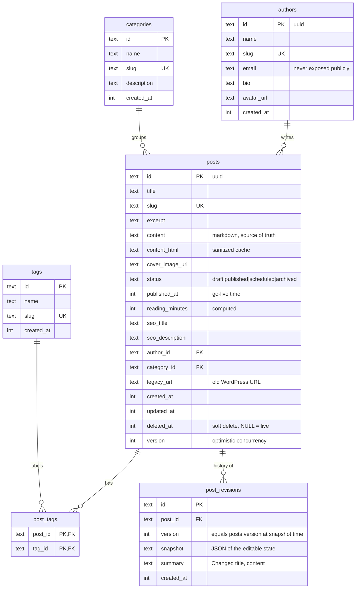

# Blog backend

The Tactyqal Labs blog used to be a separate WordPress install next to the CodeIgniter site (and `tactyqal.com/blog`
currently answers HTTP 500). This module replaces it with **one codebase, one deploy, one typed API**, plus a
migration path off WordPress.

```
Browser / mobile / CI ──► /api/v1/*  (route handlers: HTTP only, auth, envelope)
Public blog pages    ──►  src/lib/blog/*  (service layer: validation, slugs, markdown, revisions, visibility)
Admin CMS (/admin)   ──►  src/lib/db/*    (Drizzle ORM)  ──►  SQLite file (dev)  |  Turso / libSQL (prod)
```

Route handlers contain no business logic; the pages, the admin UI, the importer, the seed script and the tests all call
the same service functions in `src/lib/blog/`.

## Quick start

```bash
npm install
npm run dev          # first run auto-migrates and seeds data/blog.db (development only)
# or explicitly:
npm run setup        # migrate + seed
```

Open `/blog`, `/admin` (dev password `admin123`), and `/api-docs`. Without a `.env` file the app uses insecure
development defaults and logs a warning. Copy `.env.example` to `.env` before deploying; in production there are
**no** defaults, so admin access stays disabled until the secrets are set.

| Command | What it does |
| --- | --- |
| `npm run db:generate` | Generate a SQL migration from `src/lib/db/schema.ts` (drizzle-kit) into `drizzle/` |
| `npm run db:migrate` | Apply pending migrations (works for SQLite files and Turso) |
| `npm run db:seed` | Idempotent seed: author, categories, tags, the 6 real post titles |
| `npm run db:reset` | Delete the local SQLite file, migrate, seed (refuses remote URLs) |
| `npm run import:wordpress -- --file export.xml` | Import a WXR export |
| `npm run import:wordpress -- --url https://old-site/wp-json` | Import via the WP REST API |
| `npm test` / `npm run typecheck` | Vitest suite / `tsc --noEmit` |

## Data model



### Indexes

| Index | Serves |
| --- | --- |
| `posts_slug_uq` (unique) | Lookup by slug, uniqueness guarantee (race-safe, backed by the DB, not just app code) |
| `posts_status_published_idx (status, published_at)` | The public listing: live posts, newest first |
| `posts_category_idx`, `posts_author_idx` | Category and author filters |
| `posts_deleted_idx` | Trash view and the `deleted_at IS NULL` predicate |
| `post_tags (post_id, tag_id)` PK + `post_tags_tag_idx` | Tag filter and tag hydration |
| `post_revisions_post_version_uq (post_id, version)` | Revision lookup, and stops two writers recording the same version |

### Design decisions

- **Markdown is the source of truth.** `content_html` is rendered and sanitized (`marked` + `sanitize-html`) at write
  time, so reads never pay for rendering and raw HTML from WordPress can never reach a page unsanitized.
- **Scheduled posts need no cron.** A post is public when `status IN (published, scheduled)` and
  `published_at <= now()`, evaluated inside the query (`liveCondition` in `taxonomy.ts`). The API reports the
  *effective* status, so a due `scheduled` post reads as `published`.
- **Optimistic concurrency.** Every write bumps `version` using `UPDATE ... WHERE id = ? AND version = ?`. Send the
  version you read as `If-Match: "3"` or `"version": 3` in the body; a stale write returns `409 version_conflict`
  with `details.currentVersion`. GET returns the version as an `ETag`.
- **Revisions are append-only.** Revision N is the snapshot of the post at version N (creation is v1). Rolling back
  restores a snapshot as a *new* version, so history is never rewritten. If the old slug is taken by another post
  since, the current slug is kept.
- **Soft delete.** `DELETE` sets `deleted_at`; the slug stays reserved so URLs are never silently reused. `?hard=true`
  removes the post and its revisions. Trashed posts cannot be edited until restored.
- **Search** uses escaped, case-insensitive `LIKE` over title, excerpt and content (all words must match). At this
  scale that is plenty; the upgrade path is an FTS5 virtual table on SQLite/libSQL without changing the API.
- **Slugs** are generated from the title, made unique (`-2`, `-3`, ...) and stay stable when the title changes.

## API

Base path `/api/v1`. Full reference at **`/api-docs`**, machine-readable spec at **`/api/v1/openapi.json`**
(OpenAPI 3.1, hand-written in `src/lib/api/openapi.ts`).

| Method and path | Auth | Notes |
| --- | --- | --- |
| `GET /posts` | public | `page, limit (max 50), q, tag, category, author, sort, include=content`; `status`/`deleted` admin only |
| `GET /posts/:idOrSlug` | public (live posts) | Admins also see drafts and trashed posts; `ETag` = version |
| `POST /posts` | admin | 201 + `Location`; slug, excerpt, tags and category are optional or auto-created |
| `PATCH /posts/:id` | admin | Partial update, optimistic concurrency, records a revision |
| `DELETE /posts/:id` | admin | Soft delete; `?hard=true` permanent |
| `POST /posts/:id/restore` | admin | Undelete |
| `GET /posts/:id/revisions` | admin | Newest first |
| `GET /posts/:id/revisions/:rev` | admin | Includes the full snapshot |
| `POST /posts/:id/revisions/:rev/restore` | admin | Rollback as a new revision |
| `GET, POST /categories`, `/tags`, `/authors` | read public, create admin | Counts only include live posts |
| `POST /auth/login`, `/auth/logout`, `GET /auth/me` | | Session cookie for the admin UI |
| `POST /preview` | admin | Server-side markdown render for the editor preview |
| `GET /health` | public | Database check |

Envelope: `{ "data": ..., "meta": {...} }` or `{ "error": { "code", "message", "details" } }`. Status codes: 200, 201,
400 (bad JSON), 401, 404, 409 (`version_conflict`, `slug_taken`, trashed), 422 (`details` lists `{path, message}`),
429 (login rate limit), 500. Public GETs send `Cache-Control: public, s-maxage=60, stale-while-revalidate=300`;
anything requested with admin credentials is `private, no-store`.

```bash
KEY=dev-admin-key
curl -X POST localhost:3000/api/v1/posts -H "Authorization: Bearer $KEY" -H "Content-Type: application/json" \
  -d '{"title":"Hello","content":"# Hi","status":"published","category":"News","tags":["launch"]}'
curl "localhost:3000/api/v1/posts?q=startup&tag=pitching&sort=-publishedAt&limit=5"
curl -X PATCH localhost:3000/api/v1/posts/<id> -H "Authorization: Bearer $KEY" \
  -H 'If-Match: "1"' -H "Content-Type: application/json" -d '{"title":"Hello again"}'
```

### Authentication

Writes accept either `Authorization: Bearer <ADMIN_API_KEY>` or an httpOnly, SameSite=Lax session cookie issued by
`POST /auth/login` (checked against `ADMIN_PASSWORD`). The cookie is `v1.<expiry>.<HMAC-SHA256>` signed with
`SESSION_SECRET` using Web Crypto, so the same verifier runs in the Edge middleware that protects `/admin`. Secrets
are compared in constant time (both sides are HMAC'd first so length does not leak). Login is rate limited in memory
(8 attempts per 10 minutes per IP); use a shared store if you run several instances.

## Frontend

- `/blog`: search, category and tag filters, pagination (server rendered, works without JavaScript).
- `/blog/[slug]`: `generateMetadata` (title, description, canonical, Open Graph, Twitter), JSON-LD `BlogPosting`,
  reading time, related posts (shared tags weigh more than a shared category).
- `/blog/rss.xml`, `/sitemap.xml` (only live posts), `/robots.txt`.
- `/admin`: posts table (status tabs, search, category filter, trash), editor with Markdown plus live preview (rendered
  by the production sanitizer), status and schedule picker, tags and category, SEO fields, revision history with
  restore, conflict banner when someone else saved first, trash and restore.
- `getLatestPosts(limit)` in `src/lib/blog/public.ts` feeds the homepage and degrades to an empty list if the
  database is unavailable.

## Migrating from WordPress

```bash
npm run import:wordpress -- --file export.xml --dry-run   # preview
npm run import:wordpress -- --file export.xml             # WXR from wp-admin > Tools > Export
npm run import:wordpress -- --url https://old-site.com/wp-json
```

Maps posts, categories (first one becomes the category), tags, authors, featured image, status (`publish` ->
published, `future` -> scheduled, `draft/pending/private` -> draft; trash and pages are skipped), original URL
(`legacy_url`) and publish date (GMT). HTML is converted to Markdown for headings, links, images, lists, quotes,
code, bold and italics; anything else stays as HTML and is sanitized on save. **Idempotent by slug**: re-running
creates nothing new, updates posts whose source changed (recording a revision) and skips the rest. A hand-written
sample export lives in `scripts/fixtures/sample-wordpress-export.xml`.

Cut-over plan: import, compare counts, add 301 redirects from the old WordPress paths (`legacy_url` has the originals),
then retire the WordPress host.

## Production notes

- Set `DATABASE_URL` to a Turso URL plus `DATABASE_AUTH_TOKEN`, run `npm run db:migrate` in the deploy step.
- Set `ADMIN_API_KEY`, `ADMIN_PASSWORD`, `SESSION_SECRET` (32+ random characters), `NEXT_PUBLIC_SITE_URL`.
- Blog pages are rendered per request (`force-dynamic`) with CDN-friendly cache headers on the API; switch pages to
  ISR with `revalidate` if you want fully static HTML.

## Tests

`npm test` runs 27 Vitest tests against a throwaway SQLite file (migrations run for real): service layer (CRUD,
slug uniqueness, derived fields, optimistic concurrency, revisions and rollback, soft delete and restore, scheduled
visibility with an injected clock, search, filters, sorting, pagination, related posts), route handlers (envelope,
401, 404, 409, 422, cache headers, ETag and If-Match, cookie session, tampered and expired sessions, login rate
limit, taxonomy) and the importer (WXR parsing, REST mapping with a fake `fetch`, idempotency, sanitization).
